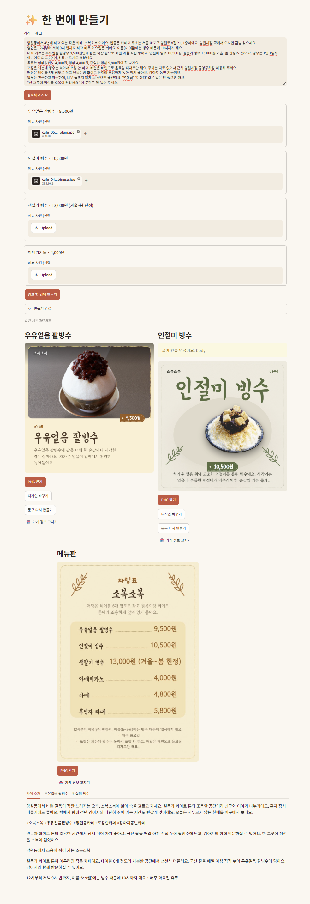

# 가게 소개 글 하나로 광고 만들기

[보고서 PDF 다운로드](docs/report.pdf?raw=true) · [업무 일지](https://app.notion.com/p/3f96e864c1d880f59bd1fe2a423a0acc?source=copy_link)

요식업 소상공인을 위한 가게 단위 광고 콘텐츠 생성 서비스

Repository: sprint-shop-profile-ad-generator

사장님이 가게 소개 글을 한 번 자유롭게 쓰면 LLM이 가게 프로필로 정리해 저장하고, 이후 메뉴마다 사진과 가격만 넣으면 광고 문구, 광고 카드, 메뉴판 이미지를 만들어 주는 서비스입니다.

메뉴 하나씩 광고를 만드는 도구가 아니라 가게 전체를 맡는 서비스로 설계했습니다. 가게 정보와 고른 디자인을 저장해 모든 메뉴에 다시 쓰므로, 메뉴마다 가게를 다시 설명할 필요가 없고 말투와 디자인이 따로 놀지 않습니다.



## 1. 문제 정의

ChatGPT에 고깃집 김치찌개 광고를 요청하면 1~2분 안에 그럴듯한 결과가 나오지만, 실제 가게가 그대로 쓰기에는 다음 문제가 있습니다.

- 음식 사진을 다시 그려서 실제 메뉴와 달라집니다.
- 문구가 어느 가게에나 맞는 일반적인 표현입니다.
- 가격이 빠집니다.
- 메뉴가 여러 개일 때 같은 가게의 느낌이 유지되는지 보장할 수 없습니다.
- 메뉴마다 가게 정보를 다시 설명해야 합니다.

이에 따라 세 가지 원칙을 세웠습니다.

- 음식은 다시 그리지 않습니다.
- 사장님이 준 사실만 씁니다.
- 가게 정보는 한 번만 입력받아 모든 메뉴에 다시 씁니다.

## 2. 핵심 사용자 흐름

```text
가게 소개 글 입력 (자유 형식)
    → LLM이 가게 프로필 추출 (이름, 업종, 영업시간, 메뉴·가격, 말투 등)
    → 사장님이 확인·수정 후 저장
    → 분위기·말투가 없으면 컨셉 선택 (안 고르면 LLM이 정해 저장)
    → 메뉴마다 사진, 가격, 특징 입력
    → 광고 문구 (인스타그램, 배달앱, 네이버 플레이스)
    → 누끼 + 배경 합성 또는 원본 사진 선택
    → 디자인 후보 3개 중 선택 (가게별 저장)
    → 광고 카드, 메뉴판 PNG 다운로드
```

첫 화면 '한 번에 만들기'에서 소개 글과 메뉴 사진을 넣고 버튼을 누르면 위 과정을 한 번에 실행합니다.

## 3. 핵심 기능

| 기능 | 설명 |
| --- | --- |
| 가게 프로필 추출 | 자유 형식 소개 글에서 14개 항목을 JSON 스키마로 추출. 글에 없는 칸은 비워 두고 지어내지 않음 |
| 확인 필요·기타 정보 | 모순되는 내용은 확인 필요로, 예약·원산지 등은 기타 정보로 분리 |
| 컨셉 | 분위기·말투가 없을 때 후보 추천 또는 원문 기반 자동 지정. 저장한 표현 방향을 문구에 재사용 |
| 광고 문구 | 가게 소개 모드(인스타·배달앱·플레이스), 메뉴 모드(인스타·배달앱) |
| 문구 검사 | 입력에 없는 숫자·원산지와 형식·반복을 코드로 검사하고 1회 교정 |
| 누끼 | rembg ISNet. 음식이 화면을 채운 사진은 '사진 그대로' 사용을 제안 |
| 배경 생성·합성 | SD1.5로 위에서 내려다본 표면 배경 생성, 음식 픽셀은 그대로 두고 1080×1080 합성 |
| 광고 카드·메뉴판 | HTML 템플릿을 Playwright로 PNG 렌더링. 스타일 6종, 배치 각 4종 |
| 디자인 후보 | LLM이 정해진 선택지 안에서 후보 3개를 고르고, 고른 디자인은 가게별로 저장 |
| 선택 옵션 | 영어 메뉴명, 원산지 표시(사장님 입력만), 반사 줄이기 |

## 4. MVP 범위

**필수 구현**

- 가게 소개 글 → 프로필 추출 → 확인·수정 → SQLite 저장
- 프로필 기반 채널별 광고 문구 생성
- 입력에 없는 사실 검사
- 광고 카드, 메뉴판 PNG 렌더링
- 정답 프로필 기반 추출 평가

**확장 (구현함)**

- 누끼 + SD1.5 배경 생성 + 합성 (이미지 레벨 2)
- 디자인 후보 추천과 가게별 저장
- 컨셉 추천·자동 지정
- 한 번에 만들기 화면

**실험만 진행**

IC-Light 조명 맞추기 (레벨 3). 음식이 다시 그려져서 서비스에는 넣지 않음. experiments/ic_light/
**제외 범위**

- 모델 학습 (프롬프트, 퓨샷 예시, 코드 규칙으로 품질 확보)
- Triton 서빙, Docker, 클라우드 배포
- 로그인, 다중 사용자

## 5. 생성 파이프라인

```text
가게 소개 글
    → 프로필 추출 (퓨샷 v2, JSON 스키마)
    → 저장된 프로필 + 메뉴 입력
    → 문구 생성 (인스타는 통 글 2편 + 짧은 표현 1개, 같은 업종·다른 스타일 우선. 부족하면 대체 또는 생략)
    → 코드 검사 (사실 / 형식 / 스타일)
    → 위반 시 1회 교정, 남으면 경고 표시
```

```text
메뉴 사진
    → EXIF 회전, 긴 변 2048px 이하로 축소
    → ISNet 누끼 (원본 / 누끼 미리보기 중 선택)
    → SD1.5 배경 생성 (업종별 표면 스타일)
    → 합성 (음식 픽셀 원본 유지)
    → HTML 템플릿 → Playwright PNG
```

**생성 원칙**

- 사실은 입력에 있는 것만 쓰고, 장면·분위기 묘사는 자유롭게 둡니다.
- 맛·품질·원산지 주장은 입력에 근거가 있을 때만 씁니다.
- 사장님 꾸밈말은 참고용으로만 쓰고 부풀리지 않습니다.
- 음식 이미지는 생성 모델로 다시 그리지 않습니다.

## 6. 모델

| 구분 | 모델 | 비고 |
| --- | --- | --- |
| 텍스트 | OpenAI GPT-6 Luna (gpt-6-luna) | 처음엔 Gemini 3.8 Flash 무료 등급, 503·504와 일일 한도로 교체. LLM_PROVIDER=gemini로 다시 선택 가능 |
| 누끼 | rembg ISNet (isnet-general-use) | U2Net 대비 음식 손실이 적어 선택. 마스크 후처리 끔 |
| 배경 | Stable Diffusion 1.5 (fp16) | 서버 시작 때 한 번 로드, attention slicing |
| 조명 (실험) | IC-Light | 서비스 미적용 |

모든 LLM 호출은 모델명, 소요 시간, 토큰 수를 logs/llm_calls.jsonl에 기록합니다.

## 7. 평가

프로필 추출 (평가용 가게 25개, GPT-6 Luna)

| 지표 | v1 (예시 없음) | v2 (퓨샷 5개) |
| --- | --- | --- |
| 전체 사실 재현율 | 70.56% | 86.69% |
| 지어낸 사실 | 2개 | 0개 |
| 상충 내용 감지율 | 50% | 75% |
| 말투 재현율 | 18.75% | 81.25% |

응답 속도 (GPT-6 Luna 평균)

| 작업 | 시간 |
| --- | --- |
| 프로필 추출 | 5.76초 |
| 가게 소개 문구 | 19.67초 |
| 메뉴 문구 | 14.22초 |
| 디자인 후보 | 7.26초 |
| 누끼 / 배경 / 합성 | 0.23초 / 3.4초 / 0.34초 |

가이드의 6개 기준(정확도, 일관성, 응답 속도, 인터페이스, 완성도, 제어 가능성)별 결과는 보고서 11장에 정리했습니다.

저장된 Luna 25건씩을 네트워크 호출 없이 다시 채점합니다. 결과는 eval/results/summary.csv와 luna-v1_*, luna-v2_* CSV에 기록됩니다.

```powershell
python -m eval.score --run-name luna-v1
python -m eval.score --run-name luna-v2
```

추출 결과 원본은 experiments/runs/luna-v1/과 experiments/runs/luna-v2/에 있습니다. 기존 eval.run_extract는 호출 provider와 별개로 Gemini 설정을 모델 메타데이터에 쓰므로, 위 명령은 제출된 Luna 결과의 재채점에 사용합니다.

## 8. 기술 스택

| 구분 | 기술 |
| --- | --- |
| Language | Python 3.12 |
| UI | Streamlit |
| Server | FastAPI, Uvicorn |
| DB | SQLite |
| LLM | OpenAI API (GPT-6 Luna), Google Gemini API (선택) |
| Image | rembg (ISNet), diffusers (SD1.5), PyTorch CUDA 12.8 |
| Rendering | Jinja2, Playwright Chromium (실행 파일 미설치 시 Windows Edge 대체) |
| Test | pytest |
| Environment | 로컬 PC, RTX 2080 Super 8GB |

## 9. 프로젝트 구조

```text
.
├── app/
│   ├── api/          # FastAPI 라우터 (profile, copy, image, render)
│   ├── services/     # 프로필 추출, 문구 생성·검사, 누끼, 배경, 합성, 렌더링
│   ├── prompts/      # 프롬프트 파일 (profile_v1/v2, copy_v1~v3, concept)
│   ├── schemas/      # Pydantic 스키마
│   └── ui/           # Streamlit 화면
├── templates/        # 광고 카드·메뉴판 HTML 템플릿, styles.json
├── data/             # 예시 글 30개, 정답 프로필, 문구 예시
├── eval/             # 프로필 채점 (run_extract.py, score.py, results/)
├── experiments/      # 실험 기록 (runs, ic_light 등)
├── tools/            # 샘플 생성·확인용 스크립트
├── tests/            # pytest
└── docs/             # 보고서 PDF, 화면 캡처, 개발 메모
```

## 10. 실행 방법

Windows PowerShell, Python 3.12 기준. 레포 폴더에서 실행합니다.

### 1. 설치 (문구·원본 사진 렌더링, GPU 없이)

```powershell
py -3.12 -m venv .venv
.\.venv\Scripts\Activate.ps1
python -m pip install -r requirements.txt
python -m playwright install chromium
Copy-Item .env.example .env
```

Chromium 설치가 네트워크 문제로 실패하면 설치된 Microsoft Edge를 사용합니다. 렌더러는 Chromium 실행 파일이 없을 때만 Edge(channel=msedge)로 대체합니다.

.env에 OPENAI_API_KEY를 넣습니다. 기본값은 OPENAI_MODEL=gpt-6-luna, IMAGE_ENABLED=false입니다.

### 2. 이미지 기능 (선택, NVIDIA GPU)

```powershell
python -m pip install torch==2.11.0 torchvision==0.26.0 --index-url https://download.pytorch.org/whl/cu128
python -m pip install -r requirements-image.txt
python tools/gpu_check.py
```

.env에서 IMAGE_ENABLED=true로 바꿉니다. 첫 실행 때 Hugging Face에서 SD1.5를 내려받습니다. IMAGE_ENABLED=false이면 SD 배경 모델을 로드하지 않습니다. /image/compose의 mode=original과 /render/ad-card는 원본 사진으로 동작합니다. 현재 Streamlit 업로드 흐름은 먼저 누끼 API를 호출하므로, 기본 설치만으로 '한 번에 만들기'가 자동으로 원본 사진 모드로 전환되지는 않습니다. 화면에서 사진을 처리하려면 이미지 패키지와 ISNet 가중치가 필요합니다. 누끼 사용 + photo_full 배치의 새 배경 합성은 IMAGE_ENABLED=true가 필요합니다.

### 3. 실행 (터미널 두 개)

```powershell
python -m uvicorn app.api.main:app --host 127.0.0.1 --port 8000
python -m streamlit run app/ui/main_ui.py
```

브라우저에서 http://localhost:8501 을 엽니다.

### 4. 테스트

```powershell
python -m pytest
```

LLM 호출은 mock 처리되어 API 키 없이 실행됩니다. .env를 만든 상태에서는 IMAGE_ENABLED=false로 두고 실행하세요. Chromium 또는 Edge가 없으면 실제 브라우저 렌더 테스트는 건너뜁니다. 제출 준비 환경에서 키 없이 실행한 결과는 382 passed (102.64초)입니다. API 상세와 옵션 설명은 docs/DEV_NOTES.md에 있습니다.

## 11. 보안 및 데이터 관리

API Key는 .env에 저장하고 커밋하지 않습니다. .env.example의 키 값은 비워 두고 모델명·timeout·경로 등의 기본값을 제공합니다.
가게 DB(*.db), LLM 호출 로그, 모델 캐시는 Git에서 제외합니다.
테스트 원본 음식 사진(data/photos/)은 Git에서 제외합니다. data/render_runs/ 광고 카드·메뉴판, 문구 화면 PNG와 experiments/ic_light/compare_grid.jpg는 추적 중이며 음식 이미지가 포함된 결과물일 수 있습니다. 사진 출처 문구는 제출자가 확인할 항목입니다. 초안에 제공된 출처 목록은 다음과 같습니다.
Walnut baguette — lazy fri13th, CC BY 2.0 (Wikimedia Commons)
Patbingsu — 국립국어원, CC BY-SA 2.0 KR (Wikimedia Commons)
Vanilla-iced mini donut with chocolate sprinkles — James St. John, CC BY 2.0 (Wikimedia Commons)
글꼴은 모두 SIL Open Font License입니다.

## 12. 진행 상태

- [x] GitHub 저장소 생성, 폴더 구조·스키마 세팅
- [x] 프로젝트 기획 및 MVP 범위 정리
- [x] 사장님 예시 글 30개, 정답 프로필 작성
- [x] 프로필 추출 API (JSON 스키마, 퓨샷 v2)
- [x] 채점 스크립트 구축 및 v1/v2 비교
- [x] 프로필 확인·저장 화면 + SQLite
- [x] 광고 문구 생성 v1 → v2 → v3, 문구 예시 1,076개 정리
- [x] 사실·형식·스타일 검사와 1회 교정
- [x] 광고 카드·메뉴판 HTML 템플릿 렌더링
- [x] GPU 환경 구축, ISNet 누끼, '사진 그대로' 기준
- [x] SD1.5 배경 생성과 합성
- [x] 디자인 템플릿 v3 (스타일 6종), 디자인 후보 추천
- [x] IC-Light 조명 실험 (서비스 미적용, 기록만)
- [x] LLM 변경 (Gemini → OpenAI GPT-6 Luna)
- [x] 컨셉 추천·자동 지정
- [x] Streamlit 화면 정리, 한 번에 만들기
- [x] 전체 흐름 테스트
- [x] 최종 보고서 작성
- [ ] main 병합 및 새 환경 실행 확인
